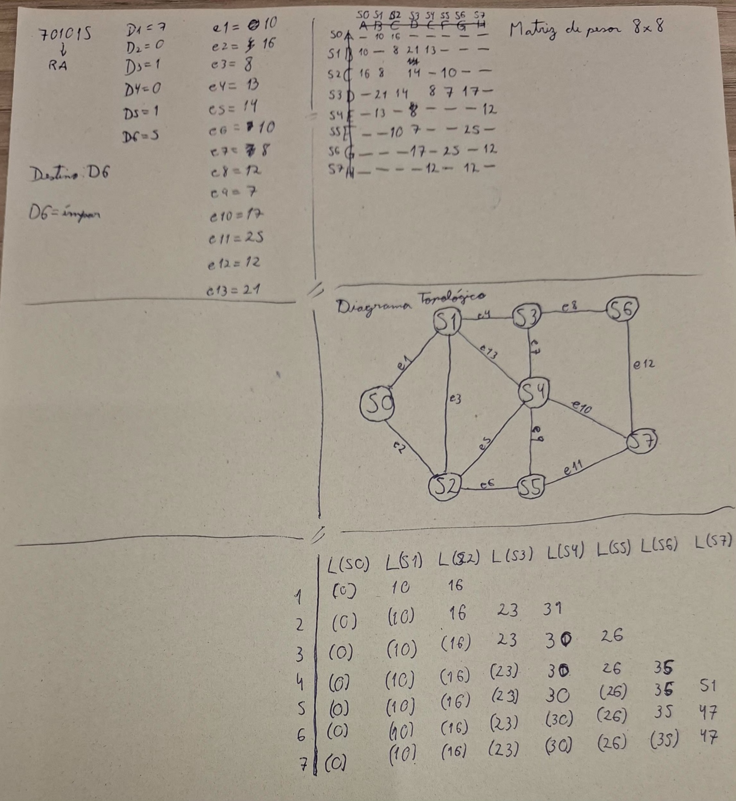
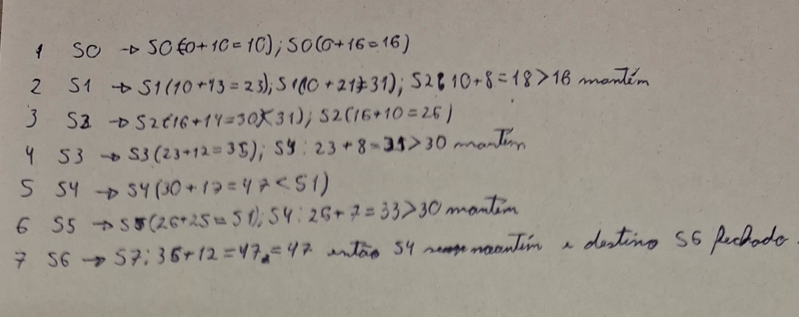
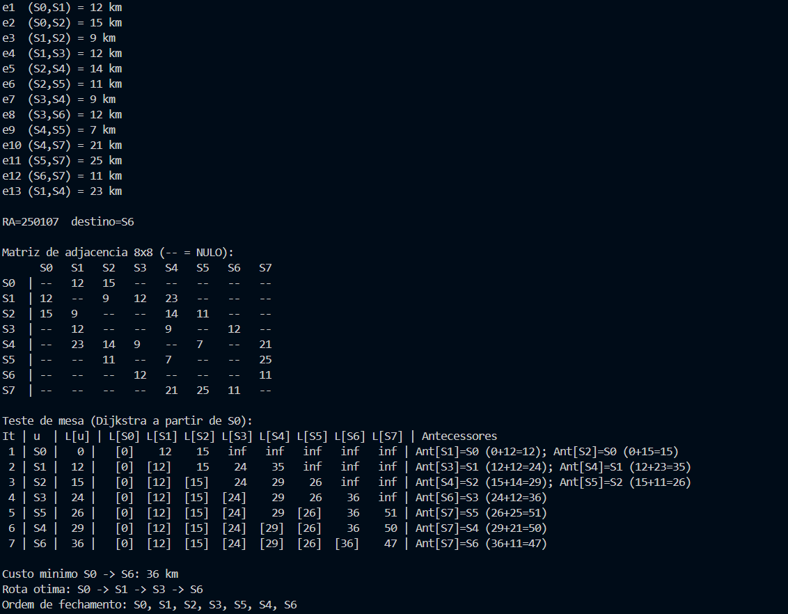

# Atividade-Murilo-EC08

As imagens 1 e 2 são fotos da minha resolução da etapa 1 e 2 da atividade sendo as tabelas e calculo de pesos, etc..
eu usei IA para gerar o código de exibição para o github.

### Imagem 1

### Imagem 2

Agora para a etappa 3 que é a de immplementação em código eu fiz a utilização de IA para a parte mais especifica de funções e tambem para a escolha das bibliotecas que eu utilizei.

Esse é um print do terminal após rodar o arquivo program.py.
os valores foram diferentes mas eu acredito que foi algum erro de código cometido por mim ou mesmo uma alucinação da IA que gerou a dispariedade e eu acredito que os resultados da minha etapa 1 são os certos.

O arquivo tem comentarios sobre o motivo de uso de cada trecho e qual sua utilidade.

## Etapa 4

### Q1

Distância = "L[S6]"
Rota = S0;S1;S3;S6
Ordem de Fechamento = S0;S1;S2;S3;S4;S5;S6

### Q2

após remover o ramal e5 = (S2;S4)

Nova Rota e Novo Custo = S0;S1;S3;S6
continua o mesmo valor

Acréscimo = 
    35 - 35 = 0 km

Explicação: e5 não fazia parte da rota ótima, então isso não afeta o destino S6.

### Q3

Custo da MST: 10 + 8 + 10 + 7 + 8 + 12 + 12 = 67 km
São 7 arestas para 8 vértices

Soma das distâncias do Dijkstra: 0 + 10 + 16 + 23 + 30 + 26 + 35 + 47 = 187 km

Por que a união das rotas radiais não gera a MST. Os dois algoritmos respondem a perguntas diferentes:

O Dijkstra minimiza, para cada destino individualmente, o custo acumulado a partir da origem. Para encurtar o caminho até S0, ele aceita ramais mais caros. Neste caso, inclui e2 (16 km), e5 (14 km) e e10 (17 km), que a MST descarta por serem mais caros que alternativas capazes de manter a rede conectada.
O Prim minimiza o custo total das arestas necessárias para manter todas as subestações conectadas, sem se preocupar com a distância de cada uma até S0. (usei IA para corrigir pontuação nesse e melhorar a coesão)
